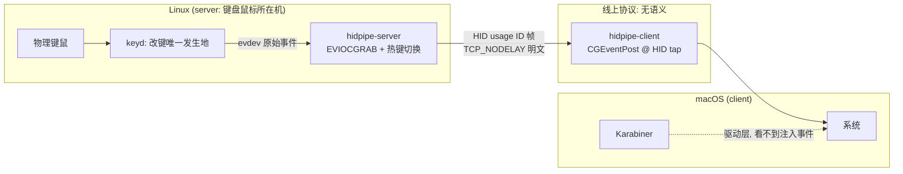

# hidpipe

跨机 HID 事件管道:Linux 捕获 → macOS 注入。名字即架构——**HID usage ID 在管道里流动**,仅此而已。

为解决 deskflow/synergy 系的三个结构性痛点而生:

1. **换键薛定谔**:keysym 翻译 + 跨机 keymap 协商是两个会漂移的状态机;
2. **延迟**:翻译层与事件循环排队;
3. **异常补救弱**:无心跳自愈、无防卡键安全阀。

## 架构



三条设计不变量:

1. **协议无语义**:线上只有原始 HID 事件。没有 keymap 协商,没有修饰键状态机,没有缓存——没有能漂移的东西。
2. **换键恰好一次,位置固定**:改键全部发生在捕获侧的 keyd(支持 `overload(control, esc)` 这类状态性改键,解析完才上线)。macOS 注入在 Quartz 层,结构性绕过 Karabiner,不会双重映射,也不依赖对端任何配置。
3. **断线即释放**:连接死亡 ⇒ server 立即 ungrab;client Drop 时释放所有按住的键。grab/按键状态随连接生灭,不留残渣。

## 构建

```bash
# Linux(捕获端)
cargo build --release -p hidpipe-server

# macOS(注入端,在 Mac 上构建)
cargo build --release -p hidpipe-client
```

也可以用 `nix develop` 拿到 Rust 工具链。

## 运行

**Linux**(需要读 `/dev/input/event*` 的权限,`input` 组即可):

```bash
hidpipe-server                    # 自动探测设备,keyd 虚拟设备优先
hidpipe-server --keyboard "keyd" --mouse "MX Master" --port 24800
```

**macOS**:

```bash
hidpipe-client <linux-ip>         # 断线每秒重试,直到成功
```

首次运行需在 **系统设置 → 隐私与安全性 → 辅助功能** 授权运行它的终端(iTerm/Terminal 等)。

**使用**:按 `ScrollLock` 在 本地 ↔ 远程 之间切换。远程模式下 Linux 侧光标冻结(设备被独占),所有输入发往 Mac;再按一次回来。切换键可用 `--switch-key pause` 等更换。

## 参数

| server | 默认 | 说明 |
|---|---|---|
| `--bind` / `--port` | 0.0.0.0 / 24800 | 监听地址与端口 |
| `--keyboard` / `--mouse` | 自动探测 | 设备名子串过滤 |
| `--switch-key` | scrolllock | 切换键:scrolllock / pause / f13..f24 |
| `--swap-caps-esc` | 关 | 捕获侧补做 caps↔esc(仅当互换不在 keyd 层时) |

| client | 默认 | 说明 |
|---|---|---|
| `--port` | 24800 | 服务器端口 |
| `--flip-scroll` | 关 | 反转滚轮方向 |

## 已知限制(v0,周末原型)

- **明文 TCP**,仅可信 LAN;TLS 在 roadmap。
- 媒体键(音量/播放)未映射——它们在 HID consumer page,不在 keyboard page。
- macOS 的 **SecureEventInput**:密码框聚焦时系统丢弃一切合成事件。这是平台策略,任何注入式方案(deskflow 同)都绕不过。
- 鼠标钳制在主屏;多屏支持在 roadmap。
- 键鼠热插拔未处理(读取失败会回本地模式并打日志,重启 server 恢复)。
- 鼠标侧键(前进/后退)未转发。

## Roadmap

- [ ] TLS(自签证书对,fingerprint 认证)
- [ ] WoL / mDNS 心跳——server 主动唤醒 client 方向
- [ ] nix 模块:systemd service(Linux)+ launchd agent(macOS)
- [ ] 多屏坐标钳制
- [ ] 媒体键(consumer page)
- [ ] 剪贴板同步(谨慎,Worst case 先不做)

**明确不做**:光标边缘检测切换。没有 compositor 协作的边缘检测靠相对位移累加,必然漂移;热键切换是确定性的,与本项目价值观一致。
