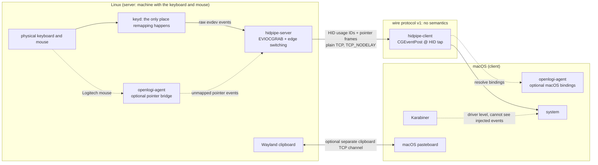

# hidpipe

Cross-machine input pipe: capture on Linux, inject on macOS. Keyboard frames carry HID usage IDs. The optional OpenLogi backend forwards mouse input before bindings are resolved, so each machine can keep its own mouse configuration.

It fixes three structural problems of the deskflow/synergy family:

1. Fragile key remapping. Keysym translation plus cross-machine keymap negotiation are two state machines that drift apart.
2. Latency. The translation layer and event loop queuing add delay.
3. Weak failure recovery. No heartbeat-based self-healing, no safety valve against stuck keys.

> [!WARNING]
> As you can see, I make many hypothesis such as openlogi/keyd, niri, wayland and Logitech device. This project is not a universal solution about device sharing in the LAN, and cannot running well in any other case.
> 
> This just a vibe project that fit my requirements.

## Architecture



Three input-channel design invariants:

1. **The protocol has no semantics.** Only raw HID and pointer events go on the wire. No keymap negotiation, no modifier state machine, no cache. Nothing that can drift.
2. **Remapping happens exactly once, at a fixed place.** `keyd` on the capture side resolves stateful keyboard remaps like `overload(control, esc)` before events go on the wire, while Quartz injection on macOS bypasses driver-level keyboard remapping (such as Karabiner). With the OpenLogi backend, mouse bindings are resolved once on whichever machine currently owns the pointer.
3. **Disconnect releases everything.** When the connection dies, the server ungrabs at once and the client releases all held keys and buttons on `Drop` (or signal). Grab, capture leases, and held-input state live and die with the connection.

### Edge switching

Earlier iterations rejected pseudo edge detection that accumulates deltas to estimate cursor position, because estimation always drifts. `hidpipe` uses two deterministic paths instead:

- **Linux → macOS:** Push the cursor past the right edge of the Linux screen. The trigger is a Wayland layer-shell barrier, so the compositor itself detects the crossing. In remote mode, Linux input devices are grabbed (freezing the local cursor) and all input goes to the Mac.
- **macOS → Linux:** Push the cursor against the left edge of the Mac display and keep pushing to hand control back. The client clamps cursor coordinates precisely and triggers return once leftward pressure within a sliding window exceeds the threshold.

## Build and manual usage

### Build

```bash
# Linux (capture side)
cargo build --release -p hidpipe-server

# macOS (injection side, build on the Mac)
cargo build --release -p hidpipe-client
```

`nix develop` provides a Rust toolchain. The flake also provides native packages for `x86_64-linux`, `aarch64-linux`, and `aarch64-darwin`:

```bash
nix build                        # server on Linux, client on macOS
nix run . -- --help
nix flake check                  # build the native package and run protocol tests
```

### Run

Linux requires a Wayland session with layer-shell support and read access to `/dev/input/event*` (membership in the `input` group is sufficient):

```bash
hidpipe-server                    # auto-detect devices, prefer the keyd virtual keyboard
hidpipe-server --keyboard "keyd" --mouse "MX Master" --port 24800
```

macOS:

```bash
hidpipe-client <linux-ip>         # retries once a second until connected
```

On first run, grant **Accessibility** access to the executable in `System Settings > Privacy & Security > Accessibility`. A `launchd` service needs its own permission; the terminal's permission does not cover it. Until event-posting access is granted, the client waits without connecting to Linux.

### CLI options

| `hidpipe-server` | Default | Description |
|---|---|---|
| `--bind <addr>` | `0.0.0.0` | Listen address |
| `--port <port>` | `24800` | Listen TCP port |
| `--keyboard <substr>` | auto-detect | Keyboard device name substring filter (prefers `keyd` virtual keyboard) |
| `--mouse <substr>` | auto-detect | Mouse device name substring filter (mutually exclusive with `--openlogi-socket`) |
| `--openlogi-socket <path>` | disabled | Capture the mouse through an OpenLogi bridge socket |
| `--clipboard` | off | Enable bidirectional text clipboard sharing on a separate TCP connection |
| `--clipboard-port <port>` | `24801` | Clipboard listen port (requires `--clipboard`; must differ from the input port) |
| `--swap-caps-esc` | off | Swap Caps Lock and Escape on capture (use only when `keyd` or `udev` does not already do so) |
| `--latency-stats` | off | Log local stage timing summaries every 5 seconds |

| `hidpipe-client` | Default | Description |
|---|---|---|
| `<server-address>` | required | Host name or IP address of the Linux server |
| `--port <port>` | `24800` | Server TCP port |
| `--openlogi-socket <path>` | disabled | Resolve mouse input with the local OpenLogi agent |
| `--latency-stats` | off | Log local stage timing summaries every 5 seconds and `[slow-inject]` records (`>= 2 ms`) |
| `--clipboard` | off | Enable bidirectional text clipboard sharing with the Linux server |
| `--clipboard-port <port>` | `24801` | Server clipboard port (requires `--clipboard`; must match the server) |
| `--input-feedback` | off | Reply with a `Pong` to every input frame to mitigate TCP delayed ACK |

## LAN clipboard sharing

Enable `--clipboard` on both peers, or set the following in both the Linux and macOS service configurations:

```nix
services.hidpipe.clipboard = {
  enable = true;
  port = 24801; # default; independent of the input port
};
```

Copying text on either machine updates the other machine's clipboard, including while input remains local. The clipboard is checked every 250 ms; command execution and network transfer add to this interval. Unicode, empty text, and trailing newlines are preserved. Images, files, rich text formatting, and the Wayland primary selection are not transferred. Text is limited to 1 MiB of UTF-8 bytes. Oversized local text is skipped; oversized or malformed incoming records close the clipboard connection.

Clipboard transfer uses a separate TCP connection so large text does not queue behind keyboard and mouse frames. Both peers record their existing clipboard on connection and synchronize subsequent changes; connecting or reconnecting does not push old clipboard contents. Received text is not echoed back. The client retries disconnected clipboard sessions every two seconds, independently of the input connection. This channel is plaintext and unauthenticated, like the input channel: enable it only on a trusted LAN. Anyone who can reach the enabled clipboard port can read subsequent copied text and replace clipboard contents.

The Linux backend requires a Wayland session and `wl-copy` / `wl-paste` from `wl-clipboard`; the Nix package includes these commands automatically. macOS uses `/usr/bin/pbcopy` and `/usr/bin/pbpaste`. With `openFirewall = true`, the NixOS module also opens the configured clipboard port when sharing is enabled. Home Manager users must open that TCP port at the system level themselves.

## NixOS and Home Manager

Add `hidpipe` to your flake inputs:

```nix
inputs.hidpipe = {
  url = "github:woxQAQ/hidpipe";
  inputs.nixpkgs.follows = "nixpkgs";
};
```

### Linux capture server (NixOS or Home Manager)

On NixOS, import the NixOS module:

```nix
{ inputs, ... }:
{
  imports = [ inputs.hidpipe.nixosModules.default ];

  services.hidpipe = {
    enable = true;
    user = "alice"; # an existing desktop user
    keyboard = "keyd";
    mouse = "MX Master";
    openFirewall = true;
  };
}
```

The NixOS module adds `user` to the `input` group and installs a `systemd` user service restricted to that user. Log out and back in after the first activation so the user service manager picks up the new group membership. The service starts and stops with `graphical-session.target`.

Alternatively, manage the Linux server via Home Manager using the same server options:

```nix
{ inputs, ... }:
{
  imports = [ inputs.hidpipe.homeManagerModules.default ];

  services.hidpipe = {
    enable = true;
    keyboard = "keyd";
    mouse = "MX Master";
  };
}
```

When using Home Manager on Linux, configure input permissions and the firewall at the system level yourself (for example, `users.users.alice.extraGroups = [ "input" ];` and `networking.firewall.allowedTCPPorts = [ 24800 ];`). Choose either NixOS or Home Manager to manage the Linux service—both define `hidpipe.service`.

The Wayland compositor must import `WAYLAND_DISPLAY` into the `systemd` user environment before starting the session target; NixOS Sway integration and UWSM handle this automatically. For compositors with a dedicated session target, set `services.hidpipe.systemdTarget` accordingly.

### macOS client (Home Manager)

On macOS, import the Home Manager module:

```nix
{ inputs, ... }:
{
  imports = [ inputs.hidpipe.homeManagerModules.default ];

  services.hidpipe = {
    enable = true;
    host = "192.168.1.10";
  };
}
```

This creates a `launchd` agent in the graphical login session (`~/Library/Logs/hidpipe.log`). The client checks event-posting permission before connecting and waits until access is granted; revoking access closes the connection on the next heartbeat and releases Linux input.

#### Persistent local signing on macOS

By default (`services.hidpipe.localSigning.enable = true`), Home Manager installs application bundles at `~/Applications/Hidpipe.app` (and `~/Applications/OpenLogi Agent.app` when OpenLogi is enabled). During activation—outside the Nix build sandbox—it signs them using a persistent certificate stored in a dedicated local Keychain under `~/Library/Application Support/hidpipe/signing` (`0700`). The private key never enters the Nix store, and the login Keychain does not need to be unlocked over SSH.

1. Open `System Settings > Privacy & Security > Accessibility`.
2. Grant access to **Hidpipe** (and **OpenLogi Agent** if enabled). Use `Cmd+Shift+G` in the file picker to select the bundles under `~/Applications`.
3. If migrating from raw Nix-store executables, authorize the new app bundles once and remove the old store entries.

Subsequent rebuilds and rollbacks reuse the same bundle IDs and certificate, preserving code identity for macOS TCC permissions. Back up `~/Library/Application Support/hidpipe/signing` privately: deleting or recreating it rotates the identity and requires re-authorization (incomplete signing state fails activation rather than silently rotating the identity). The generated certificate is valid for ten years. Set `services.hidpipe.localSigning.enable = false;` to run directly from the Nix store instead.

### Service inspection

- **Linux:** `systemctl --user status hidpipe` and `journalctl --user -u hidpipe -f`
- **macOS:** `launchctl print gui/$(id -u)/org.nix-community.home.hidpipe`

### Module options reference

| Option (`services.hidpipe.*`) | Default | Applies to | Description |
|---|---|---|---|
| `enable` | `false` | Linux, macOS | Enable the `hidpipe` service |
| `package` | native `hidpipe` package | Linux, macOS | Package providing `hidpipe-server` or `hidpipe-client` |
| `port` | `24800` | Linux, macOS | TCP port used by server and client |
| `clipboard.enable` | `false` | Linux, macOS | Enable bidirectional text clipboard sharing on the trusted LAN |
| `clipboard.port` | `24801` | Linux, macOS | Separate clipboard TCP port; use the same value on both peers |
| `latencyStats` | `false` | Linux, macOS | Log local latency counts, means, and maxima every 5 seconds |
| `user` | required | NixOS | Desktop user who runs the server and receives `input` (and `uinput`) group membership |
| `openFirewall` | `false` | NixOS | Open `services.hidpipe.port` in the firewall |
| `bind` | `"0.0.0.0"` | Linux | Listen address for the server |
| `keyboard` | `null` (auto-detect) | Linux | Keyboard device name substring |
| `mouse` | `null` (auto-detect) | Linux | Mouse device name substring (`null` required when `openlogi.enable = true`) |
| `swapCapsEsc` | `false` | Linux | Swap Caps Lock and Escape on capture |
| `systemdTarget` | `"graphical-session.target"` | Linux | User systemd target that starts and stops the service |
| `host` | required on macOS | macOS (HM) | Host name or IP address of the Linux server |
| `localSigning.enable` | `true` on macOS | macOS (HM) | Install and locally sign stable app bundles in `~/Applications` |
| `inputFeedback` | `false` | macOS (HM) | Reply with a `Pong` to each input frame to mitigate TCP delayed ACK |
| `openlogi.enable` | `false` | Linux, macOS | Route mouse input through OpenLogi with destination-side bindings |
| `openlogi.mouse` | `"MX Master"` | Linux | Physical Logitech mouse name substring (must match exactly one mouse) |
| `openlogi.device` | `null` | Linux, macOS | OpenLogi config key (`null` selects the first online device on Linux or saved selection on macOS) |
| `openlogi.socket` | `"~/.cache/openlogi-hidpipe/pointer.sock"` | Linux, macOS | Private local socket shared by `hidpipe` and `openlogi-agent` |
| `openlogi.gui.enable` | `true` | Linux, macOS | Build and install the OpenLogi GUI alongside the CLI and agent |
| `openlogi.basePackage` | `pkgs.openlogi` | Linux, macOS | Unmodified OpenLogi `0.6.25` package to which bridge patches are applied |
| `openlogi.package` | patched OpenLogi | Linux, macOS | Patched OpenLogi package built with `openlogi.gui.enable` |

## OpenLogi mouse backend

Enable the OpenLogi backend on **both** peers to evaluate mouse bindings on the active destination machine instead of forwarding Linux-generated shortcuts. The bridge patch targets OpenLogi **0.6.25** (`nix/openlogi-package.nix`), sharing the wire protocol in `proto/src/pointer.rs`. The network protocol is version `1`; a version or pointer-backend mismatch is rejected during the `Hello` handshake before capture begins.

### Configuration

On NixOS:

```nix
services.hidpipe = {
  enable = true;
  user = "alice";
  openFirewall = true;
  openlogi = {
    enable = true;
    mouse = "MX Master 2S";
    gui.enable = true; # default; retain the OpenLogi settings UI
    # device = "<OpenLogi config key>"; # required when multiple mice are configured
  };
};
```

On macOS with Home Manager:

```nix
services.hidpipe = {
  enable = true;
  host = "linux-host.local";
  openlogi.enable = true;
  # openlogi.device = "<Mac OpenLogi config key>";
};
```

### Setup notes

- **Linux device ownership:** Disable `logiops` or any other service that captures the same mouse. The NixOS module grants `input` and `uinput` membership, enables `/dev/uinput`, and reapplies `udev` permissions to connected Logitech `hidraw` devices. OpenLogi owns the physical mouse for the entire session; `hidpipe` only grabs the `keyd` keyboard when entering remote mode.
- **Excluding the mouse from `keyd`:** If `keyd`'s wildcard matches the mouse, exclude its vendor/product ID (OpenLogi preserves this ID on its virtual mouse, so one exclusion covers both). For the MX Master 2S:
  ```nix
  services.keyd.keyboards.default.ids = [ "*" "-046d:4069" ];
  ```
- **Per-machine profiles:** Use the OpenLogi GUI on each machine to configure its actions; device keys and bindings do not need to match across systems, and the mouse does not need to be physically connected to the Mac. When multiple pointing devices are configured, set `openlogi.device` explicitly.
- **macOS migration & permissions:** Quit any previously running OpenLogi agent once when switching to the managed service (`~/Library/Logs/openlogi-agent.log`) and remove its old login item. Grant Accessibility access to both **Hidpipe** and **OpenLogi Agent** (`~/Applications` when local signing is enabled).
- **GUI & package overrides:** Set `services.hidpipe.openlogi.gui.enable = false;` (or override the flake package with `withGui = false`) for a headless CLI/agent build. Override `services.hidpipe.openlogi.basePackage` if pulling OpenLogi from another `nixpkgs` input.
- **Manual execution:** Set `OPENLOGI_BRIDGE_SOCKET=<path>`, optionally `OPENLOGI_BRIDGE_DEVICE=<key>`, and on Linux `OPENLOGI_BRIDGE_MOUSE=<substr>` for `openlogi-agent`, then pass `--openlogi-socket <path>` to `hidpipe-server` and `hidpipe-client`. The socket directory must have `0700` permissions.

### Scroll behavior and lease semantics

- **Scrolling:** The wire carries wheel deltas in 1/120-notch units on both backends. On the evdev path the server reads `REL_WHEEL_HI_RES`/`REL_HWHEEL_HI_RES` when the device offers them (ignoring the legacy ±1-per-notch axis so a notch is not counted twice) and scales plain `REL_WHEEL` up by 120 otherwise. On macOS, wheel input is injected as line scrolling — one line per notch — through Quartz's fixed-point fields, so sub-notch hi-res input stays smooth. `--invert-scroll-x/-y` and `--scroll-scale-x/-y` shape scrolling at the injection point for both backends.
- **Lease safety and button quarantine:** Remote pointer capture uses a connection-scoped lease with a 750 ms heartbeat deadline. A held mouse button prevents remote entry. Disconnect, a stalled server, an input-hook failure, or a full capture queue revokes the lease and restores Linux routing immediately. Buttons still held at revocation are quarantined until physical release (sharing one atomic state with physical holds so concurrent releases are never lost), and pending gestures are cancelled before local routing resumes.
- **Hardware settings:** DPI, SmartShift, and other device-level settings belong to the Linux profile; the bridge does not forward hardware configuration changes from macOS back to the physical mouse.

## Diagnostics

### Latency diagnostics

Enable `services.hidpipe.latencyStats = true;` (or `--latency-stats`) on both machines to log stage sample counts (`n`), mean durations (`mean_us`), and maximum durations (`max_us`) every 5 seconds while connected, plus remaining samples on session exit. Diagnostics never log key codes or pointer coordinates.

- **Linux stages:** `server.queue` (capture enqueue to writer dequeue; excludes `evdev` polling interval) and `server.write` (frame serialization and socket write).
- **macOS stages:** `client.resolve` (OpenLogi IPC request/reply), `client.inject` (input handling including Quartz calls), `client.feedback` (optional reply write), and `client.process` (total frame handling, excluding blocking socket read). Stages have independent counts because OpenLogi-consumed events skip injection.
- **Slow injection records (macOS):** When `client.inject` takes at least `2 ms`, the client logs `[slow-inject]` with a sequence number, input category, completion timestamp (`epoch_us`), total time, and breakdown across cached display bounds lookup (`bounds`), input state acquisition (`state`), Quartz event creation (`create`), property configuration (`configure`), `CGEventPost` (`post`), event release (`drop`), and remaining work (`other_us`). See [`diag/macos-injection-latency.md`](diag/macos-injection-latency.md) for details.

To evaluate TCP delayed-ACK behavior against Deskflow's workaround, enable `inputFeedback` on the **Mac** alongside `latencyStats` on both peers:

```nix
services.hidpipe = {
  latencyStats = true;
  inputFeedback = true; # or --input-feedback
};
```

This replies with one `Pong` frame per input frame before local resolution or injection. Compare perceived responsiveness, TCP RTT/retransmissions, and stage timings with `inputFeedback` off and on under identical network conditions. See [`diag/deskflow-latency.md`](diag/deskflow-latency.md) and [`diag/deskflow-network.md`](diag/deskflow-network.md) for background.

### Scroll diagnostics (Linux)

Build and run the passive `evdev` wheel listener (never grabs the device or injects input):

```bash
cargo build -p hidpipe-server --example scroll
sudo target/debug/examples/scroll --list
sudo target/debug/examples/scroll /dev/input/eventN | tee /tmp/hidpipe-scroll-linux.log
```

Each output line represents one wheel-containing `SYN_REPORT` frame with elapsed time, kernel timestamp, interval since the previous wheel frame (`dt`), and raw wheel events (`REL_WHEEL`, `REL_HWHEEL`, and their `HI_RES` variants at 120 units per notch). Stop `openlogi-agent` or `hidpipe-server` first if an exclusive grab silences the physical device.

### Scroll diagnostics (macOS)

Run the passive HID event-tap listener on macOS alongside `hidpipe-client`:

```bash
swift diag/scroll.swift | tee /tmp/hidpipe-scroll.log
```

Grant the terminal Input Monitoring / Accessibility access if tap creation fails. Each line logs arrival interval (`dt`), event timestamp, `(x, y)` deltas in lines (`line`), pixels (`point`), and fixed-point (`fixed`), continuous-scroll flags, scroll/momentum phases, source PID, and modifiers.

## Known limitations

- **Plain TCP:** Intended for trusted LANs only; TLS is on the roadmap.
- **Media keys:** Volume and playback keys (HID Consumer Page `0x0C`) are not mapped yet; only Keyboard/Keypad Page (`0x07`) usages are forwarded.
- **macOS `SecureEventInput`:** When a password prompt or secure text field has focus on macOS, the system discards synthetic keyboard events from user-space injectors by policy.
- **Single-display geometry:** On Linux, the right-edge barrier is placed on every output (so seams between monitors also trigger it). On macOS, cursor movement and left-edge return detection are clamped to the main display.
- **Device hot-plug:** Losing the keyboard device (including restarting `keyd`) releases remote input and exits so `systemd` can restart the server and reopen the device. A directly captured `evdev` mouse also requires a server restart after hot-plug.
- **Native `evdev` side buttons:** Back and forward mouse buttons are forwarded with the OpenLogi backend; native `evdev` capture forwards left, right, and middle buttons.

## Roadmap

- [ ] TLS (self-signed certificate pair, fingerprint authentication)
- [x] Nix modules: `systemd` user service on Linux, `launchd` agent on macOS
- [ ] Multi-monitor support: per-output barrier configuration on Linux, cursor clamping across displays on macOS
- [ ] Map the Mac cursor's initial Y coordinate by screen height ratio when entering remote mode
- [ ] Media keys (HID Consumer Page)
- [ ] Clipboard sync (needs careful design, may stay out)
