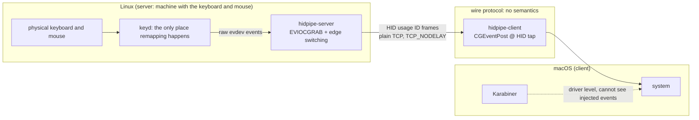

# hidpipe

Cross-machine input pipe: capture on Linux, inject on macOS. Keyboard frames carry HID usage IDs. The optional OpenLogi backend forwards mouse input before bindings are resolved, so each machine can keep its own mouse configuration.

It fixes three structural problems of the deskflow/synergy family:

1. Fragile key remapping. Keysym translation plus cross-machine keymap negotiation are two state machines that drift apart.
2. Latency. The translation layer and event loop queuing add delay.
3. Weak failure recovery. No heartbeat-based self-healing, no safety valve against stuck keys.

## Architecture



Three design invariants:

1. The protocol has no semantics. Only raw HID events go on the wire. No keymap negotiation, no modifier state machine, no cache. Nothing that can drift.
2. Keyboard remapping happens exactly once, at a fixed place. keyd on the capture side resolves stateful remaps like `overload(control, esc)` before keyboard events go on the wire. Quartz injection bypasses driver-level keyboard remapping. With the OpenLogi backend, mouse bindings are resolved exactly once on the machine currently being controlled.
3. Disconnect releases everything. When the connection dies, the server ungrabs at once and the client releases all held keys on Drop. Grab and key state live and die with the connection.

## Build

```bash
# Linux (capture side)
cargo build --release -p hidpipe-server

# macOS (injection side, build on the Mac)
cargo build --release -p hidpipe-client
```

`nix develop` provides a Rust toolchain. The flake also provides native packages
for `x86_64-linux`, `aarch64-linux`, and `aarch64-darwin`:

```bash
nix build                        # server on Linux, client on macOS
nix run . -- --help
nix flake check                  # build the native package and run protocol tests
```

## NixOS and Home Manager

Add hidpipe to your flake inputs:

```nix
inputs.hidpipe = {
  url = "github:woxQAQ/hidpipe";
  inputs.nixpkgs.follows = "nixpkgs";
};
```

On the Linux capture machine, import the NixOS module:

```nix
{ inputs, ... }:
{
  imports = [ inputs.hidpipe.nixosModules.default ];

  services.hidpipe = {
    enable = true;
    user = "alice"; # an existing desktop user
    keyboard = "keyd";
    mouse = "MX Master";
    openFirewall = true;
  };
}
```

The NixOS module adds the user to the `input` group and installs a systemd user
service, restricted to that user. Log out and back in after the first activation
so the user service manager picks up the new group membership. The service starts
with `graphical-session.target` and stops with the desktop session.

On macOS, import the Home Manager module:

```nix
{ inputs, ... }:
{
  imports = [ inputs.hidpipe.homeManagerModules.default ];

  services.hidpipe = {
    enable = true;
    host = "192.168.1.10";
    # flipScroll = true;
  };
}
```

This creates a launchd agent in the graphical login session. On macOS,
Home Manager installs real application bundles at `~/Applications/Hidpipe.app`
and, with OpenLogi enabled, `~/Applications/OpenLogi Agent.app`. It signs them
using a persistent certificate in a dedicated local Keychain; signing happens
during activation, outside the Nix build sandbox. The key never enters the
Nix store, and the login Keychain does not need to be unlocked over SSH.

Grant **Hidpipe** and **OpenLogi Agent** access in System Settings > Privacy &
Security > Accessibility. Use Cmd+Shift+G in the file picker to select the bundles
under `~/Applications`. Migration from the old Nix-store executables requires
one new authorization; their old entries may be removed manually. Subsequent
activations use the same bundle IDs and certificate, preserving code identity
across rebuilds and rollbacks. Keeping the identity is necessary for permission
reuse; verify permission retention on the macOS version in use after migration.

Back up `~/Library/Application Support/hidpipe/signing` privately. It contains
the certificate, encrypted signing Keychain, and its password, with directory
permissions 0700. Deleting or recreating it changes the signing identity and
requires authorization again. Incomplete signing state fails activation rather
than silently rotating the identity. The generated certificate lasts ten years;
renewal needs a planned identity migration. This is local signing, not Developer
ID distribution or notarization. Set `services.hidpipe.localSigning.enable = false;`
to run directly from the Nix store instead, with its original permission behavior.

Logs go to `~/Library/Logs/hidpipe.log`. The client requests event-posting
permission before connecting and waits until access is granted. Revoking access
closes the connection on the next heartbeat, releasing Linux input.

Home Manager also supports the Linux server, using the same server options as
the NixOS module:

```nix
{ inputs, ... }:
{
  imports = [ inputs.hidpipe.homeManagerModules.default ];

  services.hidpipe = {
    enable = true;
    keyboard = "keyd";
    mouse = "MX Master";
  };
}
```

When using Home Manager on Linux, configure input permissions and the firewall
at the system level yourself. On NixOS, for example:

```nix
users.users.alice.extraGroups = [ "input" ];
networking.firewall.allowedTCPPorts = [ 24800 ];
```

Choose either NixOS or Home Manager to manage the Linux service. Both use the
unit name `hidpipe.service`. The compositor must import `WAYLAND_DISPLAY` into
the systemd user environment before starting the session target; NixOS Sway
integration and UWSM handle this. For a compositor with its own session target,
set `services.hidpipe.systemdTarget` accordingly. The server requires a Wayland
session and a compositor with layer-shell support.

| module option (`services.hidpipe.*`) | default | applies to |
|---|---|---|
| `enable` | `false` | both platforms |
| `package` | native hidpipe package | both platforms |
| `port` | `24800` | both platforms |
| `user` | required when enabled | NixOS only |
| `openFirewall` | `false` | NixOS only |
| `bind` | `"0.0.0.0"` | Linux |
| `keyboard` / `mouse` | `null` (auto-detect) | Linux |
| `swapCapsEsc` | `false` | Linux |
| `systemdTarget` | `"graphical-session.target"` | Linux |
| `host` | required when enabled | macOS, Home Manager |
| `localSigning.enable` | `true` on macOS | macOS, Home Manager; stable signed application bundles |
| `flipScroll` | `false` | macOS, Home Manager |

Check the Linux service with `systemctl --user status hidpipe` and
`journalctl --user -u hidpipe -f`. On macOS, use
`launchctl print gui/$(id -u)/org.nix-community.home.hidpipe`.

## OpenLogi mouse backend

Enable this backend on **both** peers to use macOS's own OpenLogi bindings instead
of forwarding Linux-generated shortcuts. The bridge patch targets OpenLogi
**0.6.25**; `nix/openlogi-package.nix` applies it without changing dependencies.
The protocol module in `proto/src/pointer.rs` is compiled into both programs.
The editable OpenLogi worktree can link that file at
`crates/openlogi-agent-core/src/remote/wire.rs`.

On NixOS:

```nix
services.hidpipe = {
  enable = true;
  user = "alice";
  openFirewall = true;
  openlogi = {
    enable = true;
    mouse = "MX Master 2S";
    gui.enable = true; # default; retain the OpenLogi settings UI
    # device = "<OpenLogi config key>"; # required for multiple configured mice
  };
};
```

Disable logiops and other services that capture or divert the same mouse. The
module provides the patched OpenLogi GUI and agent, grants the user `input` and
`uinput` membership, and enables `/dev/uinput`. Log out and back in after changing
groups. OpenLogi owns the physical mouse for the entire session; hidpipe only grabs
the keyd keyboard when entering remote mode. If keyd's wildcard identifies the
mouse as a keyboard, exclude its vendor/product ID. For the MX Master 2S:

```nix
services.keyd.keyboards.default.ids = [ "*" "-046d:4069" ];
```

OpenLogi preserves that ID on its virtual mouse, so the exclusion covers both.
The NixOS module also reapplies udev permissions to already-connected Logitech
HID devices when its rules change.

`services.hidpipe.openlogi.gui.enable` defaults to `true`. This builds and installs
the Linux desktop launcher or macOS application bundle alongside the agent, and
leaves GUI startup to the user. Set it to `false` for a CLI and agent installation.
The package function exposes the same choice as `withGui`:

```nix
inputs.hidpipe.packages.${pkgs.stdenv.hostPlatform.system}.openlogi.override {
  withGui = false;
}
```

On macOS with Home Manager:

```nix
services.hidpipe = {
  enable = true;
  host = "linux-host.local";
  openlogi.enable = true;
  # openlogi.device = "<Mac OpenLogi config key>";
};
```

Use the OpenLogi GUI on each machine to configure that machine's actions. The Mac
agent uses its saved device selection unless `openlogi.device` is explicit; the
mouse need not be physically connected to the Mac. Linux automatically chooses
its first online pointing device unless a key is explicit. With multiple mice,
set the key explicitly on both peers. Device keys and bindings do not have to
match across systems. Quit any previously running OpenLogi agent once when
migrating to the managed service, and remove its old login item. Grant the patched
`openlogi-agent` and `hidpipe-client` Accessibility access on macOS. With local
signing enabled (the default), authorize their bundles in `~/Applications` as
described above, rather than the Nix-store executables.

The module manages `openlogi-agent.service` on Linux and a launchd agent on macOS.
The bridged package owns the capture-readiness, virtual-device identity and
mutable-config fixes; consumers do not need to apply additional OpenLogi patches.
Logs on the Mac are in `~/Library/Logs/openlogi-agent.log`. Socket paths default to
`~/.cache/openlogi-hidpipe/pointer.sock` and must be in a private directory (0700).
The agent uses `OPENLOGI_MANAGED_SERVICE=1` to leave autostart management to Nix.
Override `openlogi.basePackage` when using another nixpkgs input:

```nix
services.hidpipe.openlogi.basePackage = fastest-pkg.openlogi;
```

For manual operation, give the agent `OPENLOGI_BRIDGE_SOCKET` and optionally
`OPENLOGI_BRIDGE_DEVICE`; on Linux also give it `OPENLOGI_BRIDGE_MOUSE` (a name
substring selecting exactly one physical Logitech mouse). Pass
`--openlogi-socket <path>` to hidpipe on each machine. The agent's socket is
local-only and versioned independently of GUI IPC.

The bridge preserves high-resolution wheel movement on both axes, including
sub-notch input across pauses. The Linux virtual device keeps its original wheel
capabilities. Scroll distance is adjusted only at the destination.

On the Mac, hidpipe renders OpenLogi wheel input at 15 pixels per notch on both
axes. To adjust the scroll distance, set the Home Manager option on the Mac
(lower values scroll less):

```nix
services.hidpipe.scrollPixelsPerNotch = 15;
```

For manual operation, pass `--scroll-pixels-per-notch 15` to `hidpipe-client`.
The range is 1–65535; 30 restores the previous scroll distance. Fractional pixels
are accumulated, preserving high-resolution input at lower speeds. This setting
does not affect local Linux scrolling, native evdev input, or OpenLogi bindings
that generate their own scroll actions.

Capture is a connection-scoped lease with a 750 ms heartbeat deadline. A held
mouse button prevents entry. Disconnect, a stalled server, input-hook failure,
or a full capture queue revokes the lease and restores Linux routing. Buttons
still held at revocation are quarantined until release; pending gestures are
cancelled before Linux routing resumes. Physical holds and quarantine bits share
one atomic state, so a concurrent release cannot be overwritten by lease cleanup.
Released side buttons can begin new local clicks and gestures immediately. On
macOS, binding lookup happens before normal mouse injection, and a held button
keeps its original disposition across config
or foreground-app changes. Sub-notch main-wheel motion is retained. Hardware settings
such as DPI and SmartShift belong to the Linux profile; this bridge does not
forward hardware actions from the Mac back to the physical device.

The network protocol is version 1. Upgrade both hidpipe peers together; a
version or pointer-backend mismatch is rejected before capture. Native evdev
capture remains available when OpenLogi is disabled.

## Run

Linux needs a Wayland session with layer-shell support and read access to
`/dev/input/event*`; membership in the `input` group is enough for device access.

```bash
hidpipe-server                    # auto-detect devices, prefer the keyd virtual keyboard
hidpipe-server --keyboard "keyd" --mouse "MX Master" --port 24800
```

macOS:

```bash
hidpipe-client <linux-ip>         # retries once a second until connected
```

On first run, grant Accessibility access to the executable. A launchd service needs its own permission; the terminal's permission does not cover it. Until event-posting access is granted, the client waits without connecting to Linux.

Switching works like this. Push the cursor past the right edge of the Linux screen to enter remote mode; the trigger is a layer-shell barrier, so the compositor itself detects the crossing. On the Mac, push the cursor against the left edge and keep pushing to hand control back. In remote mode the Linux cursor freezes because the devices are grabbed, and all input goes to the Mac.

## Options

| server | default | description |
|---|---|---|
| `--bind` / `--port` | 0.0.0.0 / 24800 | listen address and port |
| `--keyboard` / `--mouse` | auto-detect | device name substring filter |
| `--swap-caps-esc` | off | redo the caps/esc swap on the capture side (only when keyd does not do it) |

| client | default | description |
|---|---|---|
| `--port` | 24800 | server port |
| `--flip-scroll` | off | reverse scroll direction |
| `--scroll-pixels-per-notch` | 15 | OpenLogi scroll distance per notch, on both axes (1–65535) |

## Latency diagnostics

Enable `services.hidpipe.latencyStats = true;` on both machines to log local
stage counts, mean durations, and maximum durations every five seconds while
connected. Manual runs accept `--latency-stats` on both executables. Remaining
samples are reported when the session ends normally or returns an error.
Diagnostics are disabled by default and never log key codes or pointer contents.
With statistics enabled, the Mac also logs `[slow-inject]` for input handling
that takes at least 2 ms. Each record includes a process-local sequence number,
input category, completion timestamp (`epoch_us`), total time, and time spent
reading cached display geometry (`bounds`), acquiring input state (`state`), creating
Quartz events (`create`), setting properties (`configure`), posting (`post`),
and releasing events (`drop`). `other_us` covers the remaining work. These are
wall-clock durations, including scheduling delays. Slow-record formatting is
outside its reported total but remains part of the enclosing `client.inject`
summary. See [the Mac injection investigation](diag/macos-injection-latency.md)
for measurements and the passive probe. Main-display ID and bounds are queried
at startup and refreshed on a background thread after CoreGraphics display
configuration notifications; pointer handling reads the cached snapshot.

The Linux log reports `server.queue` (enqueue to writer dequeue) and
`server.write` (serialization and socket write). The Mac log reports
`client.resolve` (OpenLogi request/reply), `client.inject` (input handling,
including Quartz calls), `client.feedback` (optional reply write), and
`client.process` (processing a received frame, excluding the blocking read).
Each row contains its sample count `n`, `mean_us`, and `max_us`. Stages have
independent counts: consumed OpenLogi events do not produce injection samples.
These are local durations, not end-to-end input or application display latency.
`server.queue` starts after capture, so it does not include the Linux capture
loop's polling delay. A completed write or CGEventPost call does not mean the
peer or application has processed the input.

For a comparison with Deskflow's delayed-ACK workaround, enable this option on
the **Mac**, leaving latency statistics enabled on both peers:

```nix
services.hidpipe = {
  latencyStats = true;
  inputFeedback = true;
};
```

The equivalent client flag is `--input-feedback`. It sends one existing Pong
frame per input frame, before local resolution or injection. Ping retains its
normal reply and Pong is never echoed. This needs no protocol version change
and works with an existing server. The option defaults to `false` pending
measurements and adds a reply packet per input frame with TCP_NODELAY enabled.
The server side of the new diagnostics requires the updated server package.

Compare the same movement, typing, and scrolling with `inputFeedback` off and
on; keep the mouse configuration and network unchanged. Compare perceived
responsiveness and TCP RTT/retransmissions as well as local timing summaries:
a network improvement need not change the local stage timings. Avoid inferring
macOS ACK timing from Linux's receive-side `ato` value. See
[the Deskflow source investigation](diag/deskflow-latency.md) for evidence and
remaining optimization constraints.

## Scroll diagnostics (Linux)

Build the passive evdev listener using the server's existing dependencies:

```sh
cargo build -p hidpipe-server --example scroll
sudo target/debug/examples/scroll --list
sudo target/debug/examples/scroll /dev/input/eventN | tee /tmp/hidpipe-scroll-linux.log
```

Replace `eventN` with a wheel device from `--list`. Root is only needed when
input-device permissions require it. The listener never grabs the device or
injects input. Stop with Ctrl-C.

Each line is a wheel-containing `SYN_REPORT` frame, with elapsed time, the kernel
event timestamp, the interval since the previous wheel frame (`dt`), and the
original wheel events in their original order. `REL_WHEEL` is vertical and
`REL_HWHEEL` horizontal; their `HI_RES` variants use 120 units per notch.
Ordinary and high-resolution events describe the same movement in different
units, so do not add them together. `SYN_DROPPED` warns that events were lost.

Use the physical mouse to inspect hardware input and the OpenLogi virtual mouse
to inspect forwarded local input, in separate terminals if needed. An exclusive
grab by OpenLogi or hidpipe can make the physical device silent to this listener;
stop the capturing service if a physical-device recording is needed. Diverted
thumb-wheel input handled through HID++ may not appear in physical evdev events.
This tool observes evdev, before libinput or application scroll processing.

Record five slow upward notches, pause, then five downward notches. Also try a
light touch, the horizontal wheel, and a fast spin to inspect unexpected events
or direction reversals.

## Scroll diagnostics (macOS)

Run the passive scroll listener on the Mac alongside `hidpipe-client`:

```sh
swift diag/scroll.swift | tee /tmp/hidpipe-scroll.log
```

Grant the terminal Input Monitoring / Accessibility access if tap creation fails.
The listener observes the HID event tap where hidpipe injects events, without
changing or consuming them. Stop with Ctrl-C.

Each event reports its arrival interval (`dt`), event timestamp, `(x,y)` deltas
in integer lines (`line`), pixels (`point`), and fractional lines (`fixed`), plus
continuous-scroll, scroll-phase, momentum-phase, source PID, and modifier fields.
Source PID can help distinguish hidpipe from other injectors; PID 0 may represent
system or hardware events and does not identify a particular physical device.
These are macOS events after injection, not raw Linux evdev reports or measured
application scroll distances.

For a useful comparison, record five slow upward notches, pause, then five
downward notches in remote mode. Also try the horizontal wheel and a fast spin.
Repeat with a mouse connected directly to the Mac. Keep the same foreground app
and note which capture used hidpipe; compare event spacing, delta sizes, signs,
and any unexpected events after the wheel stops.

## Known limitations (v0, weekend prototype)

- Plain TCP, trusted LANs only. TLS is on the roadmap.
- Media keys (volume, playback) are not mapped. They live on the HID consumer page, not the keyboard page.
- macOS SecureEventInput: when a password field has focus, the system discards all synthetic events. This is platform policy; no injection-based tool, deskflow included, can bypass it.
- The mouse is clamped to the main display. Multi-monitor support is on the roadmap.
- The barrier sits on the right edge of every output. With multiple monitors, the seam between two outputs triggers it too. Per-output configuration is on the roadmap.
- The return direction (Mac to Linux) only watches the left edge of the Mac's main display.
- Keyboard device loss (including a keyd restart) releases remote input and exits. The systemd service restarts the server and opens the current device. A directly captured evdev mouse requires a server restart after hot-plug.
- Side mouse buttons (back, forward) are forwarded with the OpenLogi backend; native evdev capture still forwards three buttons.

## Roadmap

- [ ] TLS (self-signed certificate pair, fingerprint authentication)
- [x] nix modules: systemd user service on Linux, launchd agent on macOS
- [ ] multi-monitor: barrier configurable per output, cursor clamping across Mac displays
- [ ] map the Mac cursor's initial Y by screen ratio when entering remote mode
- [ ] media keys (consumer page)
- [ ] clipboard sync (needs careful design, may stay out)

## Why edge switching came back

The first draft rejected pseudo edge detection that accumulates deltas to estimate the cursor position, because it always drifts. The current implementation uses two deterministic paths instead: a layer-shell barrier on the way in (the compositor itself sends the enter event), and precise cursor clamping on the client for the way back. There is no estimation anywhere.
