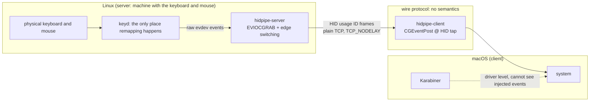

# hidpipe

Cross-machine HID event pipe: capture on Linux, inject on macOS. The wire carries HID usage IDs and nothing else.

It fixes three structural problems of the deskflow/synergy family:

1. Fragile key remapping. Keysym translation plus cross-machine keymap negotiation are two state machines that drift apart.
2. Latency. The translation layer and event loop queuing add delay.
3. Weak failure recovery. No heartbeat-based self-healing, no safety valve against stuck keys.

## Architecture



Three design invariants:

1. The protocol has no semantics. Only raw HID events go on the wire. No keymap negotiation, no modifier state machine, no cache. Nothing that can drift.
2. Remapping happens exactly once, at a fixed place. All remapping is done by keyd on the capture side, which resolves stateful remaps like `overload(control, esc)` before events go on the wire. Injection on macOS happens at the Quartz layer, below Karabiner's driver, so injected events are never remapped twice and the Mac side needs no configuration.
3. Disconnect releases everything. When the connection dies, the server ungrabs at once and the client releases all held keys on Drop. Grab and key state live and die with the connection.

## Build

```bash
# Linux (capture side)
cargo build --release -p hidpipe-server

# macOS (injection side, build on the Mac)
cargo build --release -p hidpipe-client
```

`nix develop` provides a Rust toolchain. The flake also provides native packages
for `x86_64-linux`, `aarch64-linux`, and `aarch64-darwin`:

```bash
nix build                        # server on Linux, client on macOS
nix run . -- --help
nix flake check                  # build the native package and run protocol tests
```

## NixOS and Home Manager

Add hidpipe to your flake inputs:

```nix
inputs.hidpipe = {
  url = "github:woxQAQ/hidpipe";
  inputs.nixpkgs.follows = "nixpkgs";
};
```

On the Linux capture machine, import the NixOS module:

```nix
{ inputs, ... }:
{
  imports = [ inputs.hidpipe.nixosModules.default ];

  services.hidpipe = {
    enable = true;
    user = "alice"; # an existing desktop user
    keyboard = "keyd";
    mouse = "MX Master";
    openFirewall = true;
  };
}
```

The NixOS module adds the user to the `input` group and installs a systemd user
service, restricted to that user. Log out and back in after the first activation
so the user service manager picks up the new group membership. The service starts
with `graphical-session.target` and stops with the desktop session.

On macOS, import the Home Manager module:

```nix
{ inputs, ... }:
{
  imports = [ inputs.hidpipe.homeManagerModules.default ];

  services.hidpipe = {
    enable = true;
    host = "192.168.1.10";
    # flipScroll = true;
  };
}
```

This creates a launchd agent in the graphical login session. Grant
`hidpipe-client` itself access in System Settings > Privacy & Security >
Accessibility; the terminal's permission does not cover the agent. Use
Cmd+Shift+G in the file picker to select `~/.nix-profile/bin/hidpipe-client`
(or the `bin/hidpipe-client` under your Home Manager profile). A package upgrade
changes the executable's Nix store path and may require granting access again.
Logs go to `~/Library/Logs/hidpipe.log`.

Home Manager also supports the Linux server, using the same server options as
the NixOS module:

```nix
{ inputs, ... }:
{
  imports = [ inputs.hidpipe.homeManagerModules.default ];

  services.hidpipe = {
    enable = true;
    keyboard = "keyd";
    mouse = "MX Master";
  };
}
```

When using Home Manager on Linux, configure input permissions and the firewall
at the system level yourself. On NixOS, for example:

```nix
users.users.alice.extraGroups = [ "input" ];
networking.firewall.allowedTCPPorts = [ 24800 ];
```

Choose either NixOS or Home Manager to manage the Linux service. Both use the
unit name `hidpipe.service`. The compositor must import `WAYLAND_DISPLAY` into
the systemd user environment before starting the session target; NixOS Sway
integration and UWSM handle this. For a compositor with its own session target,
set `services.hidpipe.systemdTarget` accordingly. The server requires a Wayland
session and a compositor with layer-shell support.

| module option (`services.hidpipe.*`) | default | applies to |
|---|---|---|
| `enable` | `false` | both platforms |
| `package` | native hidpipe package | both platforms |
| `port` | `24800` | both platforms |
| `user` | required when enabled | NixOS only |
| `openFirewall` | `false` | NixOS only |
| `bind` | `"0.0.0.0"` | Linux |
| `keyboard` / `mouse` | `null` (auto-detect) | Linux |
| `swapCapsEsc` | `false` | Linux |
| `systemdTarget` | `"graphical-session.target"` | Linux |
| `host` | required when enabled | macOS, Home Manager |
| `flipScroll` | `false` | macOS, Home Manager |

Check the Linux service with `systemctl --user status hidpipe` and
`journalctl --user -u hidpipe -f`. On macOS, use
`launchctl print gui/$(id -u)/org.nix-community.home.hidpipe`.

## Run

Linux needs a Wayland session with layer-shell support and read access to
`/dev/input/event*`; membership in the `input` group is enough for device access.

```bash
hidpipe-server                    # auto-detect devices, prefer the keyd virtual keyboard
hidpipe-server --keyboard "keyd" --mouse "MX Master" --port 24800
```

macOS:

```bash
hidpipe-client <linux-ip>         # retries once a second until connected
```

On first run, grant the terminal (iTerm, Terminal, etc.) access in System Settings > Privacy & Security > Accessibility.

Switching works like this. Push the cursor past the right edge of the Linux screen to enter remote mode; the trigger is a layer-shell barrier, so the compositor itself detects the crossing. On the Mac, push the cursor against the left edge and keep pushing to hand control back. In remote mode the Linux cursor freezes because the devices are grabbed, and all input goes to the Mac.

## Options

| server | default | description |
|---|---|---|
| `--bind` / `--port` | 0.0.0.0 / 24800 | listen address and port |
| `--keyboard` / `--mouse` | auto-detect | device name substring filter |
| `--swap-caps-esc` | off | redo the caps/esc swap on the capture side (only when keyd does not do it) |

| client | default | description |
|---|---|---|
| `--port` | 24800 | server port |
| `--flip-scroll` | off | reverse scroll direction |

## Known limitations (v0, weekend prototype)

- Plain TCP, trusted LANs only. TLS is on the roadmap.
- Media keys (volume, playback) are not mapped. They live on the HID consumer page, not the keyboard page.
- macOS SecureEventInput: when a password field has focus, the system discards all synthetic events. This is platform policy; no injection-based tool, deskflow included, can bypass it.
- The mouse is clamped to the main display. Multi-monitor support is on the roadmap.
- The barrier sits on the right edge of every output. With multiple monitors, the seam between two outputs triggers it too. Per-output configuration is on the roadmap.
- The return direction (Mac to Linux) only watches the left edge of the Mac's main display.
- Hot-plug is not handled. A failed read falls back to local mode and logs; restart the server to recover.
- Side mouse buttons (back, forward) are not forwarded.

## Roadmap

- [ ] TLS (self-signed certificate pair, fingerprint authentication)
- [x] nix modules: systemd user service on Linux, launchd agent on macOS
- [ ] multi-monitor: barrier configurable per output, cursor clamping across Mac displays
- [ ] map the Mac cursor's initial Y by screen ratio when entering remote mode
- [ ] media keys (consumer page)
- [ ] clipboard sync (needs careful design, may stay out)

## Why edge switching came back

The first draft rejected pseudo edge detection that accumulates deltas to estimate the cursor position, because it always drifts. The current implementation uses two deterministic paths instead: a layer-shell barrier on the way in (the compositor itself sends the enter event), and precise cursor clamping on the client for the way back. There is no estimation anywhere.
